# yaesu-netradio user manual

Remote operation of a Yaesu FT-897D (and, untested, FT-891) through a Raspberry Pi and a Digirig: WSJT-X and other
programs over the network, and voice from a web page with a headset.

> ## ⚠️ Beta software: use at your own risk
>
> This project is **beta** and still being tested. It has run one FT-897D, on one Raspberry Pi 4, with one Digirig,
> from Mac laptops. The FT-891 support and Windows voice have **not** been tried on real hardware yet.
>
> **Remote operation is at your own risk.** The software can key your transmitter. A bug, a network fault or a radio
> fault can leave you unable to see or stop what the radio is doing. You remain the control operator and are
> responsible for every transmission, for identifying, and for following your licence's rules on remote control. Before
> you rely on it remotely, have a way to switch the radio's power off from where you are (see
> [Safety](#9-safety-what-the-software-does-and-what-it-cant)).
>
> **One lock-up has happened** (see [Known issues](#12-known-issues-and-limitations)). The radio stopped answering
> and had to be power-cycled at the radio. The most likely cause is CAT polling while transmitting, but that isn't
> proven. The polling has been reduced, and checks have been added that notice a radio that stops answering.

---

## Contents

1. [What it does](#1-what-it-does)
2. [What you need](#2-what-you-need)
3. [Installing](#3-installing)
4. [First-day setup and calibration](#4-first-day-setup-and-calibration)
5. [Operating from the web panel](#5-operating-from-the-web-panel)
6. [Audio settings reference](#6-audio-settings-reference)
7. [Administration page reference](#7-administration-page-reference)
8. [Command-line options](#8-command-line-options)
9. [Safety: what the software does, and what it can't](#9-safety-what-the-software-does-and-what-it-cant)
10. [Troubleshooting](#10-troubleshooting)
11. [Testing](#11-testing)
12. [Known issues and limitations](#12-known-issues-and-limitations)
13. [Yaesu CAT documentation](#13-yaesu-cat-documentation)
14. [Files, updating and removing](#14-files-updating-and-removing)

---

## 1. What it does

<p align="center">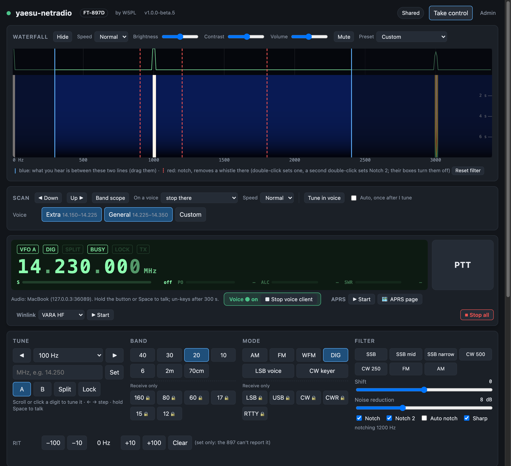<br><em>The web panel: the radio it is connected to beside the name, waterfall and scan on top, the radio display with its meters and PTT, then Tune, Band, Mode and Filter side by side. (Taken on the simulated radio, with some bands and modes locked.)</em></p>

The radio and Digirig stay at home, plugged into a Raspberry Pi. From any computer on your network or VPN you get:

- **Audio processing:** noise reduction (a standard method and a neural one), automatic and manual notch, levelling
  (AGC), bass and treble, voice squelch, a software FM squelch, and removal of the clicks that CAT data leaks into the
  audio. On transmit: microphone levelling, compression, a clarity boost, filters and a limiter. The limiter keeps
  your peaks at the drive level you set.
- **Filtering:** the receive passband is set by sliders, preset buttons, or by dragging its edges in the waterfall.
- **Waterfall and spectrum** of the receive audio. Point at a signal to read its frequency, and double-click to notch
  a whistle.
- **Voice auto-tuning ("Tune in voice"):** it listens to an SSB voice and moves the dial until the voice sounds right.
- **Voice scan and band scope:** it steps through the voice segments you pick, stops on a voice and tunes it in.
- **"LSB voice"** on the FT-897D: real LSB on the air, even though the radio only takes rear-jack audio in its USB
  data mode.
- **Repeaters and favorites:** one click sets frequency, mode, shift, offset and tone, plus your audio settings if
  you like.
- **Sharing:** several people can watch. Only one has control at a time, with hand-over requests and optional
  passwords.
- **Safety un-keys** for lost audio, lost connections, timeouts, high SWR, locked bands and a radio that stops
  answering.
- **WSJT-X, VARA and Pat** use the radio through the standard Hamlib network protocol.

## 2. What you need

| Item | Notes |
|---|---|
| Yaesu FT-897D (or FT-897) | FT-891: see the README's FT-891 section; not yet tested on a real radio |
| Digirig (Mobile) and its FT-897 cables | It provides CAT, audio, and PTT on RTS |
| Raspberry Pi 4 (or similar) | Tested with Ubuntu 24.04; Raspberry Pi OS should work. Wired Ethernet or a clean Wi-Fi link |
| A Mac or Windows laptop | Mac: Homebrew, Python 3, and BlackHole 2ch for WSJT-X. Windows: Python 3 x64 and VB-Audio Virtual Cable |
| A headset | For voice. Wired is best; Bluetooth works but adds delay |
| A VPN for use away from home | WireGuard or similar. **Never** forward these ports to the internet |
| A way to cut the radio's power remotely | Strongly recommended, e.g. a smart switch on the DC supply with the radio's internal batteries removed |

## 3. Installing

### 3.1 The radio (FT-897D)

| Menu | Setting | Why |
|---|---|---|
| 019 CAT RATE | **38400** (or match `--baud`) | Must equal the bridge's baud rate. Power-cycle the radio after changing it |
| 038 DIG MODE | **USER-U** | The panel's DIG = USB data. The 897 only takes rear DATA-jack audio in DIG/PKT modes |
| AGC, NB, DSP, IPO, ATT | as you like | These have no CAT command, so set them on the front panel before you leave |
| Squelch / RF gain knob | **RF gain fully clockwise** for remote use | A closed squelch mutes the rear jack, and there's no CAT command to open it. Use the panel's FM squelch instead |
| Internal batteries | **out** for unattended use | With them in, the radio stays on when you cut the DC |

### 3.2 The Raspberry Pi

1. Plug the Digirig's USB cable into the Pi.
2. Get the project onto the Pi: `git clone https://github.com/jwheeler188/yaesu-netradio`
3. Install it. The installer asks for your sudo password, installs Hamlib, alsa-utils and pyserial, and sets up the
   `ft897-netbridge` service:
   ```bash
   cd ~/yaesu-netradio/pi && ./install.sh
   ```
   If your cable keys the radio by CAT instead of RTS: `./install.sh --ptt CAT`. Any option from
   [section 8](#8-command-line-options) can be added.
4. Check that it found the radio:
   ```bash
   journalctl -u ft897-netbridge -n 30 --no-pager -o cat
   ```
   You should see `radio answering: 14.0740 MHz` (or your frequency).

### 3.3 Mac

1. Install [Homebrew](https://brew.sh), then BlackHole 2ch (`brew install --cask blackhole-2ch`), then restart.
2. Run `macOS/install.sh` once. It also sets up the panel's **Start voice client** button (see 5.7); to set up only
   that, run `macOS/install-link.sh`. Run it again if you move the folder.
3. For WSJT-X and other data modes, double-click **macOS/Start FT-897 Audio.command**. For voice, double-click
   **macOS/Start FT-897 Voice.command**. The first start asks for the Pi's address and saves it in `server.txt`.
4. macOS may refuse to open the files the first time: right-click › Open.

### 3.4 Windows

1. Install Python 3 **x64** from python.org and tick "Add python.exe to PATH". Use x64 even on ARM PCs.
2. Install VB-Audio Virtual Cable (vb-audio.com/Cable) and restart.
3. Double-click **windows/Start FT-897 Audio.bat** (data) or **windows/Start FT-897 Voice.bat** (voice). The first
   start installs PyAudio and asks for the Pi's address.
4. For the panel's **Start voice client** button, double-click **windows/install-link.bat** once (for your Windows user
   only; no administrator needed).
5. Windows voice is untested (including install-link.bat), and neural noise reduction isn't available on Windows yet.

### 3.5 WSJT-X, VARA, Pat

- WSJT-X › Settings › Radio: Rig **Hamlib NET rigctl**, Network Server **`<Pi address>`:4533**, PTT **CAT**, Mode
  **Data/Pkt**. Audio: Mac **BlackHole 2ch** in and out; Windows Input **CABLE Output**, Output **CABLE Input**.
- VARA (via xara or similar): `--ptt rigctld:<Pi address>:4533`. Pat: rig address `<Pi address>:4533`.
- Only one audio client runs at a time: the data client (WSJT-X) or the voice client.

### 3.6 Winlink on the Pi (optional)

Winlink email can run on the Pi itself, so no laptop software is needed: xara (a VARA HF-compatible modem, MIT
licence, included in `third_party/xara`) and [Pat](https://getpat.io) (the mail program).

- **The easy way:** `./install.sh` asks "Also set up Winlink email on this Pi?" (it installs Dire Wolf for APRS too). Or run `pi/winlink-install.sh` any time.
  It installs the build tools and Pat, adds the loopback sound card that joins xara and the bridge (card 10, so the
  other sound cards keep their numbers), offers to install Rust with rustup if Rust 1.85 or newer isn't there (about
  250 MB in your home folder, no sudo, checked against its published checksum), builds xara with no internet (about
  3 minutes on a Pi 4) and installs it as `~/.local/bin/xara`. Steps already done are skipped.
- **Pat:** Ubuntu 24.04's own `pat` is 0.15.1, which has no settings page. For a newer one, put Pat's package
  (`pat_<version>_linux_arm64.deb` from [github.com/la5nta/pat/releases](https://github.com/la5nta/pat/releases)) in the
  `winlink/` folder before running the installer. A newer xara source archive (`xara….zip` / `.tar.gz`) there is used
  instead of the bundled one. Git ignores everything in `winlink/`.
- Then restart the bridge if it was already running. The panel's **Winlink** tab says "Not ready: …" until all is there.

See [5.11](#511-winlink-email) for using it.

## 4. First-day setup and calibration

Do these once, at the radio if you can, into a **dummy load** or at low power.

1. **Administrator password.** Open `http://<Pi address>:8080/admin`. The first visit sets the administrator password.
   Use one you don't use anywhere else, because the page isn't encrypted on your network.
2. **Bands.** On the administration page, lock the bands your antenna can't handle, and check the band edges against
   your licence. The defaults are the US band edges.
3. **Pi sound levels** (administration page, *Sound levels on the Pi*). Starting points measured on the author's
   radio: **Receive (Mic capture) 12** gives about −30 dBFS of receive noise with no clipping. **Transmit (Speaker)
   2**: the ALC starts at about −10 dBFS of app audio. The bridge sets these at every start, and again whenever the
   Digirig is plugged back in (the Digirig resets itself to very loud defaults).
4. **Transmit drive.** Key into a dummy load with the voice client's test tone or WSJT-X and watch the panel's ALC
   meter. Set **Drive** so the ALC just moves on voice peaks. On the author's radio that was −5 dBFS for FM and −4 to
   −3 for SSB. In WSJT-X, set Pwr so there's no ALC (about −12 dB).
5. **FM squelch.** Tune to an empty FM channel and raise **FM squelch** until the hiss is muted (8 is a good start;
   below 6 it never closes). The thresholds assume Mic capture 12, so recheck if you change that.
6. **Operator password** (optional, recommended if others can reach the Pi). Taking control then asks for it.
7. **Check your on-air audio** with a friend, a web SDR, or your repeater's audio monitor page if it has one.

## 5. Operating from the web panel

Open `http://<Pi address>:8080` in any browser: Mac, Windows, phone.

The page runs top to bottom in the order you use it: the **waterfall**, then **Scan** and **Tune in voice**, then the
**radio display** (frequency, mode, thin meters and the PTT button), then one row with **Tune · Band · Mode ·
Filter** side by side, so changing band, mode or filter needs no scrolling. On a computer the radio display stays
pinned to the top of the window when you scroll down to the tabs (Audio & filters, Favorites, Repeaters, Options,
Connected). On a narrow window the columns stack.

### 5.1 Top bar

- **Take control / Release.** This gives your computer the radio. If someone else has it, they're asked to hand it
  over. With no answer in 30 s you get it (configurable). The administrator can take over at once, which ends their
  transmission. Control is released after 2 minutes without contact.
- **Shared** shows who has control. The **Connected** tab lists every computer connected. **Admin** opens the
  administration page.

### 5.2 Frequency, mode, VFO

- **Frequency:** scroll a digit or click its upper or lower half. ← → tune by the chosen step. You can also type a
  frequency (14.250 = MHz) and press Set. Each band button remembers your last frequency and mode in that browser.
- **Bands and modes you may transmit on come first.** Receive-only ones (locked on the administration page, with a
  padlock) follow after a "Receive only" line. The **Options** tab can hide them on your computer, and the
  administrator can hide them for everyone. The band and mode you are on always stay visible.

<p align="center">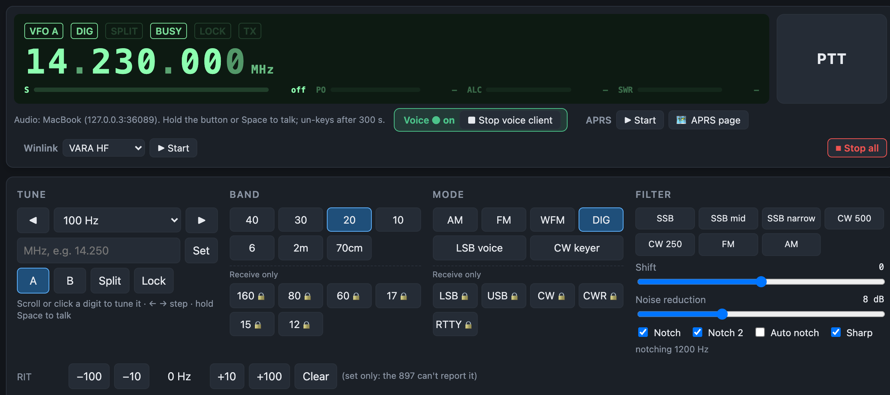<br><em>Bands and modes you may transmit on first; the locked ones, with a padlock, after "Receive only". The Filter column is on the right.</em></p>

- **Modes:** LSB, USB, CW, CWR, AM, FM, WFM, RTTY, DIG, and **LSB voice**. For voice through the Digirig use **DIG**
  for USB and **LSB voice** for LSB. In plain LSB/USB the FT-897 ignores the Digirig's audio. "Voice through the
  Digirig" (Options tab) makes the band buttons pick these for you.
- **LSB voice:** the radio stays in DIG with its dial 3 kHz below the carrier, and the Pi flips the audio. It is
  real LSB on the air. The panel shows the true LSB frequency, and the radio's own display shows 3 kHz less. It needs
  the voice client, and doesn't work with split or VFO A/B.
- **VFO A/B, Split, Lock** are under Tune. **RIT** shows below the deck in SSB, CW and DIG; it can be set but not
  read back (the 897 can't report it).
- **FM** (this row replaces RIT in FM): repeater shift, offset, CTCSS tone, Tone/TSQL, DCS/DSQL, and **Simplex** (turns shift and tones off). The
  897 can't report these either, so the panel shows what was last set over CAT, and "?" until something sets them.
  The transmit frequency is shown in amber, or red when it would be out of band or locked.

<p align="center">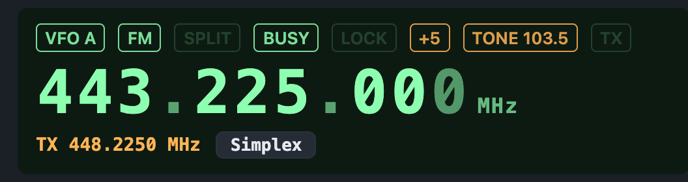<br><em>FM on a 70 cm repeater: +5 MHz shift and 103.5 Hz tone shown in amber, the transmit frequency below, and Simplex to clear them.</em></p>

### 5.3 Meters

Thin bars inside the radio display.

- **S-meter** while receiving. With an audio client connected it is off by default, because reading it puts faint
  clicks into the audio. Click the S-meter (or tick **Live S-meter** in the Options tab) to turn it on; the voice
  client removes most of the clicks.
- **PO (power), ALC, SWR** while transmitting. The FT-897 reports them in 16 steps, not watts or a ratio. Power is
  relative to the power set on the radio.

### 5.4 Waterfall

- It shows the receive audio from 0 to 3.4 kHz, newest line at the top. The FT-897 has no wide-band output, so this
  is not a band scope.
- The **blue lines** are your passband: drag them. A **red line** is a notch. Double-click to set the first manual notch, double-click again
  to set **Notch 2**; with both on, a double-click moves the nearer one. Drag a red line to move it. Dashed red lines
  without a box are the auto notches.
- Point at a signal to read its audio frequency and, in SSB/DIG, its RF frequency.
- Speed, brightness and contrast are remembered. While you transmit it shows your transmit audio with a red edge.
- Up to 6 viewers at once. It stops while the browser tab is hidden.

<p align="center">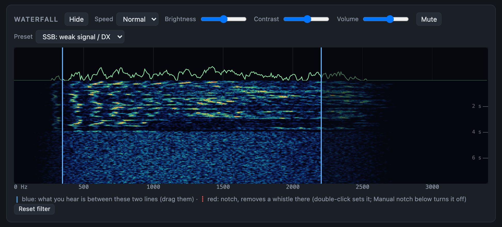<br><em>A weak SSB voice with the "SSB: weak signal / DX" preset: the blue lines are the 350–2200 Hz passband, and you can drag them.</em></p>

### 5.5 Tune in voice (USB, LSB, DIG)

Press **Tune in voice** while someone is talking. After 4 s or more it moves the dial so the voice sounds natural.
Press it again to stop, or **Undo** to go back. On a weak voice it keeps listening for up to 45 s, and after 9 s it
offers its best guess as a button. "Automatically, once after I tune" does this once after each dial change. It moves
your transmit frequency too.

It works from the voice's overtones, so it needs speech and does nothing when it's unsure. In simulation it was sure
about 83% of clips at 10 dB above the noise and 56% at 0 dB, and about 1 in 60 of those were wrong, usually by
100–250 Hz. FT8 and similar signals can fool it.

<p align="center">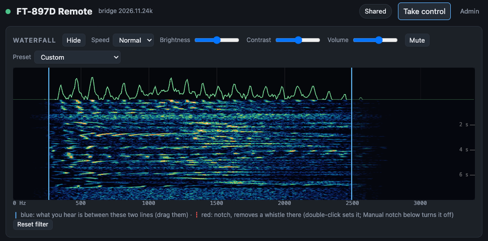<br><em>A 20 m voice. The evenly spaced peaks in the spectrum are the overtones that Tune in voice measures: when they line up as a natural voice, the dial is right.</em></p>

### 5.6 Scan and band scope (USB, LSB, DIG)

- **Up / Down** step 1.5 kHz through the voice segments you tick: US Technician, General, Extra; the 60 m channels;
  SSB parts of 6 m, 2 m and 70 cm; or a **Custom** range. The scan stops only for a voice. Then it tunes the voice in
  and does what **On a voice** says: stop there, go on when it goes quiet, or go on after 10 s.
- **Skip always** remembers a frequency in that browser.
- **Band scope** draws the range in 2.3 kHz pieces. Click a signal to tune to it.
- Using PTT or tuning by hand stops the scan, and that PTT press transmits nothing.
- 200 kHz takes about 48 s to scope and about 80 s to scan. Broadcast music can stop it, and a station that is silent
  as the scan passes is missed.

### 5.7 PTT

Hold the **PTT** button or the **Space bar**. Release to un-key. If the browser closes or the network drops, the Pi
un-keys within about 1 s. After any safety un-key, a PTT that is still held does nothing: press it again.

**Start / Stop voice client.** Under the radio display:

- **▶ Start voice client** shows when no audio client is connected. It starts "Start FT-897 Voice" on the computer
  you are using, in its own Terminal (Mac) or command window (Windows). The browser asks the first time whether to
  allow it. It needs the one-time setup from section 3 (install-link); without it the button does nothing.
- **■ Stop voice client** ends the voice client on this computer; its window stays open and says so. Only the
  computer it runs on, or the administrator, can stop it, and not while transmitting.
- Closing the browser does **not** stop the voice client: it keeps playing the radio until you stop it here, close
  its window, or press Ctrl-C in it.

### 5.8 Repeaters and favorites

- **Repeaters tab:** search, filter by band, add, edit, mark favorites. **Import** a CSV exported from your own
  RepeaterBook account, or a CHIRP CSV. The list is stored on the Pi, so every computer sees the same one. The
  project ships with an empty list, because RepeaterBook data may not be redistributed.
- **Favorites tab:** **Save what I have now** stores the frequency, mode and repeater settings, and optionally the
  receive and transmit audio settings (never volume, mic gain or drive). One click brings it all back, from any
  computer.

### 5.9 Recording and test tone

- **Record** (button or the `r` key) saves the last 30 s and what follows to `~/FT897 Recordings`. `_raw.wav` is the
  radio's audio untouched; `_heard.wav` is after the processing.
- **Test tone 3 s:** after a confirmation, it keys the radio with 3 s of 1 kHz at the Drive level. The tone starts
  only once the voice client says it's ready. A second click, leaving the page or losing the network ends it. On
  SSB/DIG a tone is full power: turn the power down or use a dummy load. Identify, and remember that linked
  repeaters carry it everywhere.

### 5.10 CW keyer (send CW from the keyboard)

The FT-897 can't send CW over its CAT cable, so the **CW keyer** mode button does it through DIG: the radio sits in DIG
with its dial one pitch (700 Hz) below the carrier, and the Pi plays a keyed tone with soft edges. On the air that is a
single carrier switched on and off: CW, as clean as from the KEY jack. The display shows the carrier, where you are on
the air, and band locks check that. Sending needs no voice client; you need it to listen. The radio's own **CW** and
**CWR** buttons stay for listening with its CW filter (they would need a key in the KEY jack to send).

<p align="center">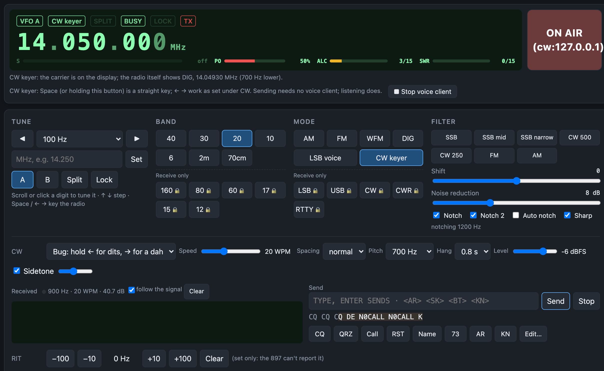<br><em>The CW keyer sending typed text: what has gone out is grey, the rest is highlighted. The settings row, the received text on the left and the Send box with its buttons on the right.</em></p>

- **Keys:** **Space** (or holding the PTT button) is a straight key in every setting. **← →** work as a **bug** (hold
  ← for a stream of dits, → for a dah as long as you hold it) or as **iambic paddles** (← dit, → dah; squeeze for
  alternating). In CW keyer mode ↑ ↓ tune instead of ← →.
- **Timing:** you hear the sidetone in this browser at once; the radio sends your exact timing 0.25 s later, so the
  network can't change a dit. The radio stays keyed for the **Hang** time after your last element.
- **Speed** 5–50 WPM, **Spacing** (Farnsworth: characters at full speed, slower overall), **Pitch** (400–1000 Hz; the
  dial moves with it so the carrier stays put), **Level** (watch ALC, like the Drive slider), **Sidetone** on/off and
  volume.
- **Send box:** type and press Enter; keep typing while it sends. The grey text has gone out, the highlighted text is
  waiting. Prosigns: `<AR>` `<SK>` `<BT>` `<KN>` `<AS>` `<BK>`. **Stop** or **Esc** stops at once. The buttons below
  (CQ, QRZ, Call, RST, Name, 73…) send their text; **Edit…** changes them and sets your call sign. `{CALL}` is your
  call sign, `{RST}` whatever is in the Send box (599 if empty).
- **Received:** the Pi decodes what it hears at your pitch and shows the text, with the tone, the other station's speed
  and the signal strength. **Follow the signal** moves to a station up to about 150 Hz off. It copies clean signals
  well; weak, fading or crowded ones less so, like every decoder.
- **Safety:** if the browser stops answering while a key is held, the key is let go after 1 s; a key held 15 s is let
  go. The administrator can lock **CW keyer** under Modes. Another computer taking control clears your queue.

### 5.11 Winlink email

With [Winlink on the Pi](#36-winlink-on-the-pi-optional) installed, the **Winlink** tab has your call sign, grid,
VARA bandwidth (500, 2300 or 2750) and **Drive** (start at −12 dBFS and check for no ALC, as with WSJT-X).

<p align="center">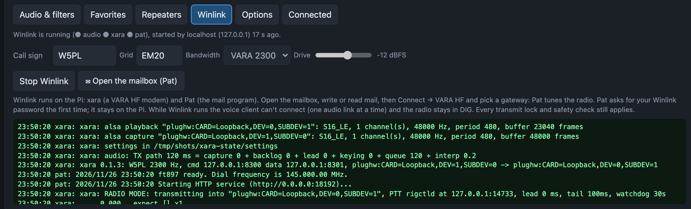<br><em>The Winlink tab while Winlink runs: xara, Pat and the audio link are up, with their latest log lines below.</em></p>

1. **Start Winlink.** If the voice client is connected, the panel asks to stop it: there is one audio link at a time.
   The radio goes to DIG.
2. **Open the mailbox (Pat)** opens Pat's page on the Pi (port 8092). Write mail, then **Connect** → **VARA HF**, pick
   a gateway from the list and connect: Pat tunes the radio and xara does the rest. Pat asks for your Winlink password
   the first time; it stays in Pat's settings on the Pi.
3. **Stop Winlink** when you are done.

xara keys the radio through the bridge's CAT port, so every lock, the transmit time limit and the high-SWR shutdown
apply. If another computer takes control, Winlink stops. The tab shows the last lines of xara's and Pat's logs. Pat's
page has no password of its own: anyone who can open the panel can open it while Winlink runs.

### 5.12 APRS

APRS runs on the Pi with [Dire Wolf](https://github.com/wb2osz/direwolf) as the modem, digipeater and iGate (installed by
`pi/winlink-install.sh`, or `sudo apt install direwolf`). Like Winlink, it takes over the radio while it runs: the radio goes
to the APRS frequency in FM, the voice client can't connect, and every transmit lock and safety check applies, because Dire Wolf
keys the radio through the bridge.

APRS has **its own page**, `http://<Pi address>:8080/aprs`: the panel's **APRS** tab has Start/Stop, a status line and
**Open the APRS page**. Keep it open on another screen or a tablet; it uses the same sign-in and control rules as the panel.

<p align="center">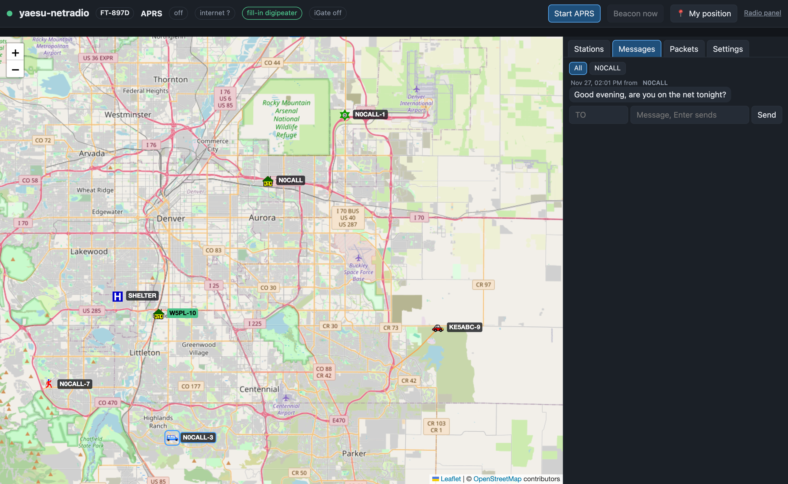<br><em>The APRS page: the map with each station's symbol, a moving station's track, internet stations outlined in blue, and the Messages tab. (Test stations.)</em></p>

- **Top bar:** whether APRS is running and on which frequency, internet, digipeater and iGate status, **Start / Stop APRS**,
  **Beacon now** (your position, once) and **📍 My position** (then click the map where your station is).
- **Map:** every station with a position, with its APRS symbol and call; your own in green. Moving stations leave a short track
  (orange; dashed blue if from the internet). Click a station for its comment, distance and bearing, how it was heard, its speed and
  altitude, and a **Message** button. Online the map is OpenStreetMap; without internet it uses the maps downloaded to the Pi (below).
- **Weather stations:** their popup shows temperature, humidity, wind (direction, speed, gusts), pressure, rain (last hour, 24
  hours, since midnight), snow and sunlight, whatever the station sends, in your units; the list shows their temperature.
- **Stations:** the same stations as a list, newest first, with distance and bearing, how long ago, and the path. Type in
  "Find a station" to filter; click one to see it on the map. **Clear list** empties the list and packet log.
- **Messages:** one button per station you've exchanged messages with. Messages to you are acknowledged automatically, every time a
  copy arrives, and shown once; yours are sent with a number and repeated after 30, 60, 120 and 240 s until acknowledged:
  "✓ delivered", or "✗ no answer" after 5 tries (about 11 minutes). "✗ refused by their radio" means the other station's radio sent
  back a reject: usually its message memory is full, or it is set not to accept messages. Bulletins heard show below. The tab (and the panel's APRS tab) shows a red count of unread messages.
- **Packets:** everything heard, with what came from the internet in blue and what this station sent in amber.
- **Maps (offline maps):** download maps to the Pi so the map works with no internet. Choose **Around** (your position or
  the centre of the map now), **Radius**, **Detail up to** (zoom 10 region, 12 towns and main roads, 14 streets, 16 most detail),
  **Street detail within** (the zooms above 12 only within this distance: much smaller files) and the **Map** (USGS topo or
  imagery, public domain, US only). It shows the number of tiles and the size before anything is downloaded, and refuses more than
  the administrator's limit or the free space. Downloading runs on the Pi: the page can be closed, and **Cancel** stops it.
  **Saved on the Pi** lists each area with **Show**, **Update** (fetches what is missing) and **Delete**. **Map shown** is
  *automatic* (online with internet, offline without), OpenStreetMap, or an offline map. Areas are MBTiles files in
  `~/.local/share/yaesu-netradio/maps` on the Pi. Typical sizes: 15 miles to zoom 14 with streets within 5 miles, about 5 MB;
  60 miles to zoom 14 with streets within 15 miles, about 100 MB.

<p align="center">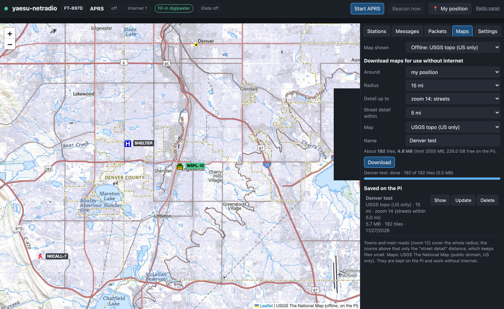<br><em>An offline USGS topo map, drawn from the Pi with no internet, and the Maps tab with the download settings and the saved area. (Test stations.)</em></p>

- **Settings:** your call sign with an SSID (-10 is usual for a home station or iGate), symbol, position (grid square or
  latitude/longitude, or the 📍 button), comment, beacon interval (or off), path (WIDE2-1 for a fixed station, WIDE1-1,WIDE2-1
  for mobile or portable), your region's APRS frequency, **internet stations**, and **Units** (miles, mph and feet, or kilometres,
  km/h and metres; kept per browser).
- **Internet stations:** stations near you from APRS-IS, read only. Anything that came from the internet and was not heard on
  the radio is outlined in **blue** on the map, in the list and in messages, so you always know whether you can reach a station by
  radio. The Pi checks for internet when APRS starts and every few minutes; without it, the internet features switch off by
  themselves and come back when it returns.
- The digipeater and iGate are set on the [administration page](#7-administration-page-reference): fill-in digipeating
  (WIDE1-1) is on out of the box; wide-area digipeating, extra aliases and the iGate are there too.
- Not yet: worldwide offline maps (Protomaps), a second receiver for APRS in the background, weather and HF APRS.

## 6. Audio settings reference

All audio settings live in the **voice client** on your laptop. They're remembered in `~/.ft897-audio.json` and
changed from the panel's **Audio & filters** tab. Double-click a slider to put it back to its default.

<p align="center">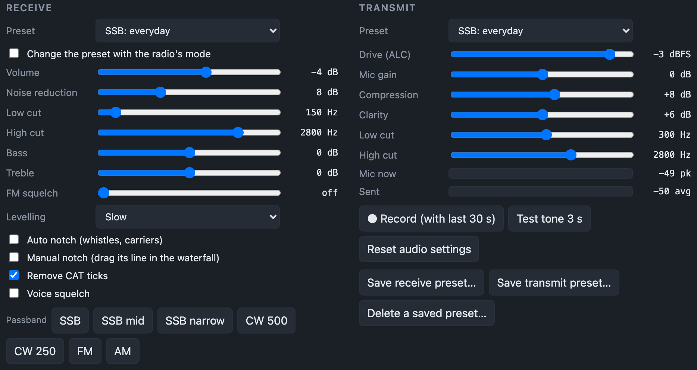<br><em>The Audio & filters tab: receive on the left, transmit on the right.. The Notch 2 sliders show while Notch 2 is ticked.</em></p>

### 6.1 Receive

| Setting | Range | Default | What it does / advice |
|---|---|---|---|
| Volume | −40 to +20 dB | −12 | Headset volume. Also beside the waterfall and on the `+` `-` keys |
| Mute | | off | Receive is also muted automatically while you transmit (loop protection) |
| Noise reduction | 0 (off) to 24 dB | 8 | How much noise is removed. Standard method: 8 has no artefacts, 13 is slightly watery, 20 clearly "tinkles". For weak voices more is not better: try 6–10 |
| Noise method | Standard / Neural (RNNoise) | Standard | **Standard** removes steady hiss. **Neural** is a small network trained on speech, and adds 20 ms of delay. On one 40 m recording it kept the voice about 7 dB louder at the same noise; on a very weak 20 m voice it turned the voice down too. Compare both on the same station. Mac only for now |
| Low cut / High cut | 50–1500 / 600–3400 Hz | 100 / 2800 | The passband. Also on the preset buttons (SSB, SSB mid, SSB narrow, CW 500, CW 250, FM, AM) and the blue lines in the waterfall |
| Shift | −1000 to +1000 Hz | 0 | Moves the whole passband up or down without changing its width, like a radio's IF shift: slide away from a station next to you. The blue lines follow it. Presets, the passband buttons and Reset filter set it back to 0; dragging an edge adds the shift into the cuts |
| Sharp filter edges | on/off | on | Cuts signals just outside the passband hard: about 47 dB down 100 Hz outside the edge and 62 dB at 200 Hz (the gentler filter of earlier versions: 7 and 12 dB). The edge itself is where a signal is 6 dB down. Turn it off only to compare |
| Bass / Treble | ±12 dB | 0 | Tone controls (500 Hz / 1.5 kHz shelves) |
| Levelling | Off / Slow / Fast | Off | AGC. Fast suits nets with mixed signal levels |
| Auto notch | on/off | off | Finds and removes whistles and carriers (−62 dB on a steady tone). Leave it off for CW |
| Notch, Notch at, width | 100–3300 Hz, 20–400 Hz | off, 1000, 100 | Double-click the waterfall to place it |
| Notch 2, Notch 2 at, width | 100–3300 Hz, 20–400 Hz | off, 1500, 100 | A second manual notch: a second double-click places it. With auto notch on you can have up to 6 notches at once (2 manual, 4 automatic) |
| Remove CAT ticks | on/off | on | Repairs the clicks CAT data leaks into the audio; loud speech is left alone |
| Voice squelch | on/off | off | Mutes when no voice is detected |
| FM squelch | 0 (off) to 30 | 0 (presets: 8) | Mutes by the hiss above the voice. 8 is a good start; below 6 it stays open |

**Receive presets:** SSB everyday, SSB noisy band, SSB weak signal / DX, SSB net, AM, CW wide, CW narrow, FM strong
repeater, FM AllStar standard, FM noisy signal, No processing. "Change the preset with the radio's mode" switches
presets automatically. Presets you save yourself are stored in that browser.

**Crowded band tips:** narrow the passband (SSB narrow, 350–2200 Hz) and use **Shift** to move it away from the
neighbour's splatter, keeping Sharp filter edges on. Watch the waterfall: put the loud signal outside a blue line.

**Weak-signal tips:** use a wired headset; use "SSB: weak signal / DX"; keep Noise reduction moderate; replay with
Record; and set the radio's DSP and noise blanker before you leave. A quieter antenna helps more than any processing.

### 6.2 Transmit

| Setting | Range | Default | What it does / advice |
|---|---|---|---|
| Drive (ALC) | −20 to −1 dBFS | −5 | Where your peaks are limited. Set it so the ALC just moves (section 4). The administrator can cap it |
| Mic gain | ±20 dB | 0 | Extra microphone gain before processing |
| Compression | 0 to 14 dB | 8 | Raises quiet syllables. 2–4 for a natural sound, 8 for DX punch |
| Clarity | 0 to 12 dB | 6 | Presence boost around 2 kHz |
| Low cut / High cut | 80–500 / 2000–3200 Hz | 300 / 2800 | FM presets use 300–3000 to keep voice clear of the CTCSS tone |

**Transmit presets:** SSB everyday, SSB DX punch, SSB natural, FM AllStar style, FM louder. The meters **Mic now** and
**Sent** show your levels live.

### 6.3 Keys in the voice client window

`+` `-` volume · `n` noise reduction (off / 8 / 13 / 20) · `]` `[` transmit drive · `r` record.

## 7. Administration page reference

`http://<Pi address>:8080/admin`. Nothing changes until you press **Save** (**Undo** discards your changes).

<p align="center">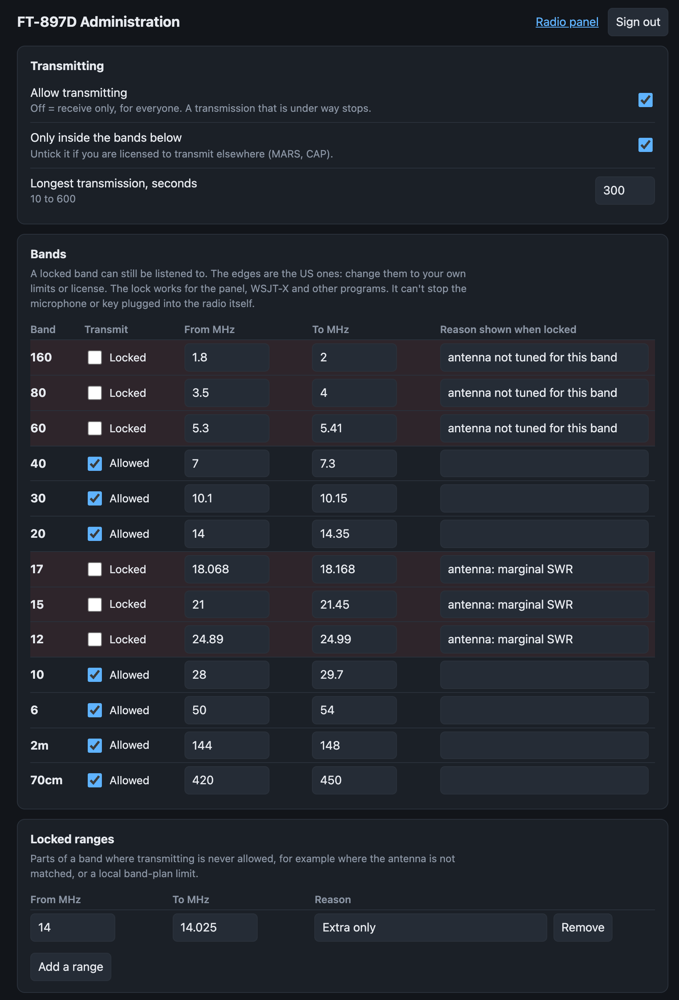<br><em>Transmitting, bands and locked ranges (the Modes card, which sits between them, is shown next). In this example, bands the antenna can't handle are locked with a reason, and 14.000–14.025 MHz is locked as Extra-only.</em></p>

<p align="center">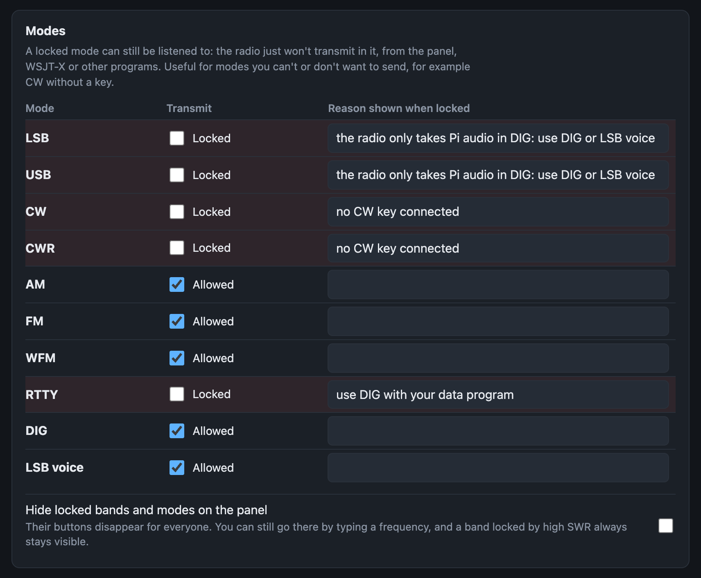<br><em>Modes. In this example plain LSB/USB are locked because the FT-897 only takes the Digirig's audio in DIG, CW because no key is connected, and RTTY in favour of DIG with a data program.</em></p>

<p align="center">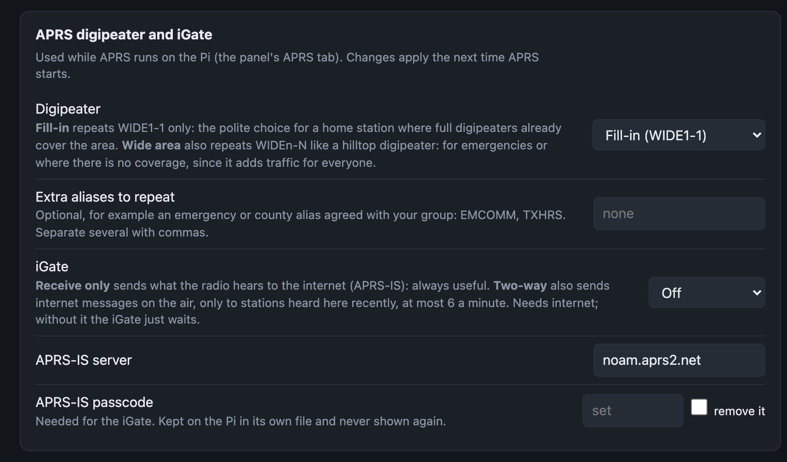<br><em>APRS digipeater and iGate: fill-in digipeating out of the box; the passcode is kept apart and never shown again.</em></p>

<p align="center">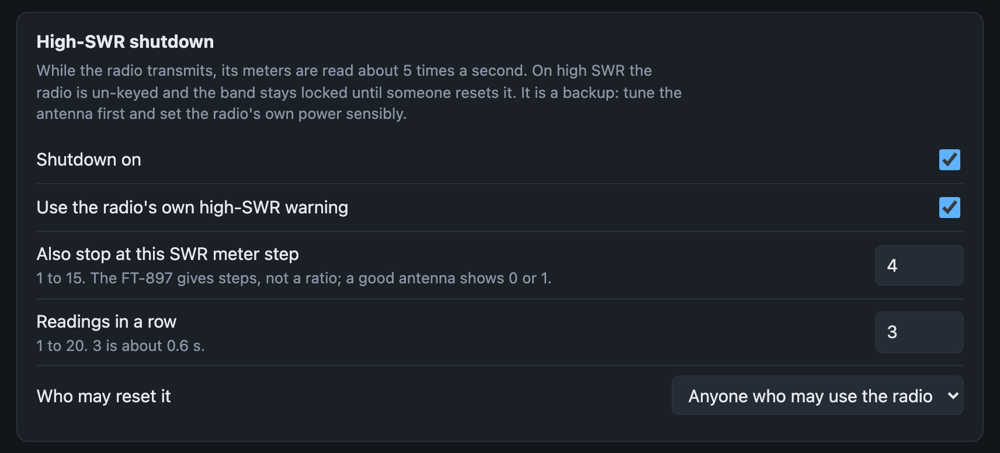<br><em>High-SWR shutdown with its default settings.</em></p>

<p align="center">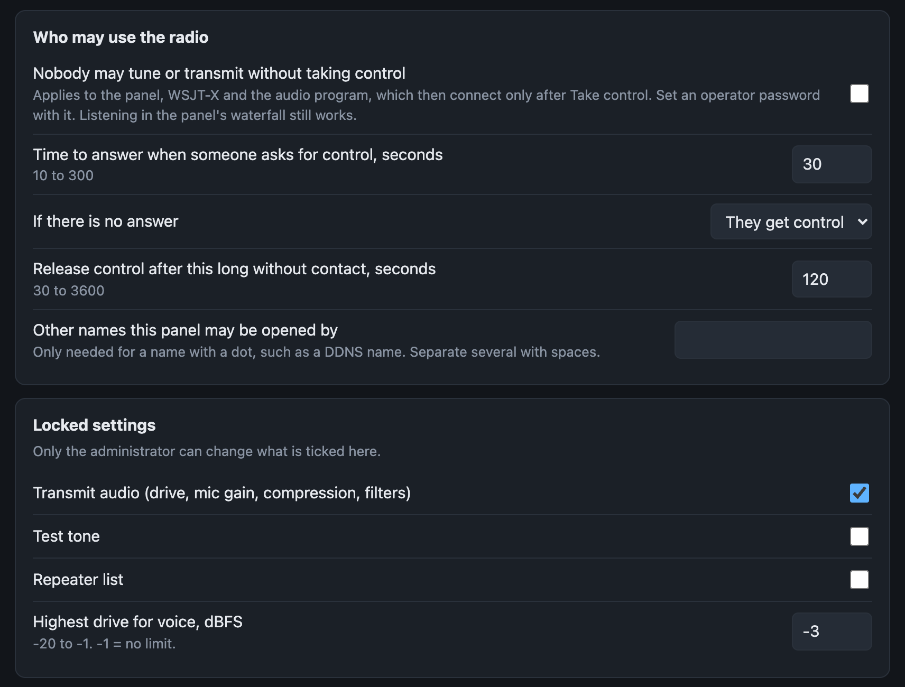<br><em>Who may use the radio, and settings that only the administrator may change.</em></p>

<p align="center">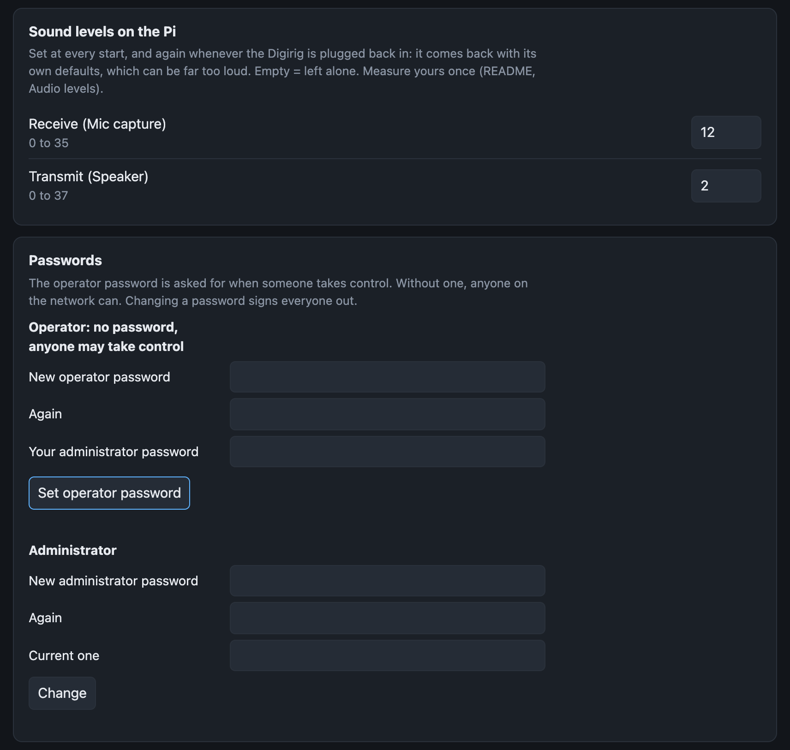<br><em>The Pi's sound levels (12 and 2 on the author's radio) and the passwords.</em></p>

| Section | Setting | Default | Notes |
|---|---|---|---|
| Transmitting | Allow transmitting | on | Off = receive only, for everyone; a transmission under way stops |
| | Only inside the bands below | on | Untick it if you're licensed outside the amateur bands (MARS, CAP) |
| | Longest transmission | 300 s | 10–600 s. Then the radio is un-keyed |
| Bands | Transmit per band, From/To MHz, reason | US edges | A locked band can still be listened to. Applies to the panel, WSJT-X and all CAT programs. It can't stop the microphone or a key plugged into the radio |
| Modes | Transmit per mode, reason | all allowed | A locked mode can still be listened to: the radio won't transmit in it from the panel, WSJT-X or other CAT programs. Switching into a locked mode while transmitting is refused, and changing to one on the radio itself un-keys it |
| APRS | Digipeater | fill-in | Off; fill-in (repeats WIDE1-1: the polite choice where full digipeaters cover the area); wide area (also WIDEn-N, like a hilltop digipeater: for emergencies or no coverage) |
| | Extra aliases | none | Further names to repeat, e.g. an emergency or county alias agreed with your group |
| | iGate | off | Receive only (radio to the internet) or two-way (internet messages on the air, only to stations heard here recently, at most 6 a minute). Needs internet and the passcode |
| | APRS-IS server / passcode | noam.aprs2.net / none | The passcode is kept in its own file on the Pi (`aprs-secret.json`) and never shown again; tick "remove it" to delete it |
| | Largest offline-map download | 2000 MB | The APRS page's Maps tab refuses anything bigger, and anything that would leave less than 1 GB free |
| | Hide locked bands and modes on the panel | off | Their buttons disappear for everyone. A band locked by high SWR always stays visible |
| Locked ranges | From/To MHz, reason | none | E.g. where your antenna isn't matched, or a local band-plan limit |
| High-SWR shutdown | Shutdown on | on | The meters are read about 5 times a second while transmitting |
| | Use the radio's own high-SWR warning | on | |
| | Also stop at this SWR meter step | 4 (FT-891: 7) | 1–15. A good antenna shows 0 or 1. The author's radio read step 2 at about 1.3:1 |
| | Readings in a row | 3 | 1–20; 3 is about 0.6 s |
| | Who may reset it | anyone who may use the radio | or only the administrator. The band stays locked until reset |
| Who may use the radio | Nobody may tune or transmit without taking control | off | Turn it on together with an operator password |
| | Time to answer a control request | 30 s | 10–300 |
| | If there is no answer | They get control | or They don't |
| | Release control after no contact | 120 s | 30–3600 |
| | Other names this panel may be opened by | none | Only for names with a dot, e.g. a DDNS name. Other websites can't control the radio |
| Locked settings | Transmit audio, Test tone, Repeater list | off | Only the administrator can change the ticked ones |
| | Highest drive for voice | −1 (no limit) | −20 to −1 dBFS |
| Sound levels on the Pi | Receive (Mic capture), Transmit (Speaker) | empty | 0–35 / 0–37. Empty = left alone. See section 4 |
| Passwords | Operator password, administrator password | none | Stored as scrypt hashes. Five wrong tries block that computer for 5 minutes. Forgot the admin password: delete `pi/passwords.json` on the Pi (the locks stay) |

## 8. Command-line options

### 8.1 Bridge (on the Pi): `ft897-netbridge.py`

Add them to `./install.sh`, which writes them into the service. Run `python3 ft897-netbridge.py --help` for the full
list.

| Option | Default | Meaning |
|---|---|---|
| `--radio ft897d\|ft891` | ft897d | Which radio |
| `--serial` | the Digirig's CP2102 | CAT serial device |
| `--baud` | 38400 (FT-891: found by asking) | Must equal the radio's CAT RATE menu |
| `--ptt RTS\|DTR\|CAT` | RTS (FT-891: CAT) | How to key the radio |
| `--ptt-serial` | the CAT device | Separate device for RTS/DTR keying |
| `--model` | usual | Hamlib model, e.g. 1023 = FT-897, 1022 = FT-857 |
| `--card` | first USB sound card | ALSA device |
| `--cat-port` / `--audio-port` / `--web-port` | 4533 / 4534 / 8080 | Network ports (web 0 = off) |
| `--bind` | 0.0.0.0 | Address to listen on |
| `--stall` | 1.5 s | Un-key if the laptop's transmit audio stops this long |
| `--no-audio-check` | off | Allow keying with no laptop audio link (e.g. an external CW keyer program). The panel's own CW keyer doesn't need it. Use with care |
| `--xara` | ~/.local/bin/xara | xara, for Winlink on the Pi |
| `--pat` | pat-winlink or pat | Pat, for Winlink on the Pi |
| `--pat-port` | 8092 | Pat's mailbox page while Winlink runs |
| `--dummy` | off | Test mode: no radio, no serial port, no sound card |
| `-v` | | Log PTT, frequency changes and connections |

### 8.2 Laptop client: `client/ft897-audio.py`

| Option | Default | Meaning |
|---|---|---|
| `--server` | from `server.txt`, else asks | The Pi's address |
| `--voice` | off | Use your headset (the system's default devices) instead of BlackHole / VB-CABLE |
| `--open-panel` | off | Open the web panel in the browser |
| `--rx-audio` / `--tx-audio` | BlackHole 2ch / CABLE | Audio devices (part of a name, or `default`); `--list` lists them |
| `--rx-buffer` / `--tx-buffer` | 200/160 ms (voice 400/300) | Raise on poor Wi-Fi; lower for less delay |
| `--rx-gain`, `--nr`, `--voice-peak`, `--mic-gain` | last used | Starting volume, noise reduction, drive, mic gain |
| `--no-processing` | off | Send the microphone as it is |
| `--rec-dir` | `~/FT897 Recordings` | Where recordings go |
| `-v` | | Log buffer under- and overruns |

## 9. Safety: what the software does, and what it can't

**The bridge un-keys the radio itself:**

- when the laptop's transmit audio stops for 1.5 s (network drop, laptop asleep, client closed)
- when the program that keyed it disconnects (WSJT-X crash, network drop), or the panel's PTT heartbeat stops for
  about 1 s
- after the longest-transmission time (300 s by default)
- on high SWR, or when the dial is turned into a locked band or range (within about half a second)
- when the radio stops answering. The bridge checks the radio's own status bytes, which Hamlib can't fake: tuning and
  transmitting are refused until the radio answers again.
- after every un-key, it asks the radio whether it is really back in receive. If not, it un-keys again, locks
  transmitting, and shows the problem in red on the panel. A radio that comes back still transmitting after it
  stopped answering is un-keyed at once.

**Also:** transmit audio reaches the radio only while it is keyed by CAT. Receive audio is muted at the laptop while
transmitting, so it can't loop back. The end of each transmission isn't cut off. Requests from other websites are
refused, raw CAT bytes from programs are refused, and a held PTT doesn't re-key after a safety un-key.

**What it can't do:**

- It can't switch the radio off, and it can't stop the microphone, a key, or another program plugged into the radio
  itself.
- If the radio itself hangs while transmitting, no command reaches it. **Have a remote power cut.**
- The FT-897's meters are coarse (16 steps). The SWR shutdown is a backup, not a substitute for a matched antenna.
- The radio's own repeater shift (ARS) and front-panel changes are not seen by the software.

**Recommended:** a remote-switchable DC supply with the internal batteries removed; the radio's own power set
sensibly; first sessions at low power, watched from the shack; a timeout on the radio where it has one (FT-891 TX
TOT, menu 05-14).

## 10. Troubleshooting

| Symptom | What to check |
|---|---|
| Panel says the radio is not answering | Is the radio on? Is CAT RATE (019) the same as `--baud`? Is the CAT cable seated? `journalctl -u ft897-netbridge -n 50`. If the radio's screen is dark or it is warm and unresponsive, see [Known issues](#12-known-issues-and-limitations) |
| WSJT-X "rig control error" | Same as above. Network Server is `<Pi address>:4533`, not a `.local` name over a VPN |
| No waterfall, or a waterfall but no sound | Is an audio client connected (its window says "connected")? Is your headset the system's sound output? Mac: the client warns if output is left on BlackHole. Check the Pi's Receive level (12) |
| Radio doesn't key | `--ptt RTS` vs `CAT` for your cable; the log shows "radio KEYED". Is transmitting allowed, and the band unlocked (admin)? Did you take control? Is an audio client connected (needed unless `--no-audio-check`)? |
| PTT refused, "out of band" | The transmit frequency (shown under the dial) is outside an unlocked band. Check the repeater shift and offset, or press Simplex |
| Voice heard but nobody hears you | DIG or LSB voice, not plain USB/LSB. The Tone is on and correct for the repeater. Drive isn't too low (watch the ALC and Sent meters) |
| Audio drops out, "network stall", TX underruns | Wi-Fi. Use 5 GHz, keep the laptop near the access point, close Wi-Fi scanners and the Wi-Fi settings pane, and on a Mac try AirDrop off. Put the Pi on Ethernet if you can. Raise `--rx-buffer` |
| Faint crackle in receive | CAT data leaking into the audio. Keep "Remove CAT ticks" on, and leave Live S-meter off when you don't need it |
| Noise reduction sounds watery or "tinkles" | Lower it to 6–8, or compare the Neural method |
| Weak station unreadable | See the weak-signal tips in 6.1 |
| Bluetooth headset silent or robotic | Wait for the 2 s mic warm-up. Both RX and TX must show the same rate (24000 Hz for AirPods). Wired is better |
| "radio in use by …" | Another laptop's audio client is connected. Close it there; an idle one is replaced after 5 s |
| Admin password forgotten | Delete `pi/passwords.json` on the Pi, then open /admin to set a new one |
| Digirig re-plugged and levels far too loud | The bridge restores the admin page's levels automatically; check that they are filled in |
| Bridge won't start | `journalctl -u ft897-netbridge -n 50`. Is the radio's serial port taken by another program? Never open the CAT port with another program while the bridge runs (RTS = PTT) |

**Restarting the bridge** drops audio for a few seconds, signs everyone out and clears Take control. Check that
nothing is transmitting first: `sudo systemctl restart ft897-netbridge`.

## 11. Testing

### 11.1 What has been tested

| Area | Status |
|---|---|
| FT-897D CAT, PTT on RTS, meters, FM repeater shift and tone | On air, one radio |
| Voice on FM (repeaters) and SSB (DIG and LSB voice) | On air; LSB voice confirmed on frequency on several web SDRs |
| WSJT-X over the network | On air |
| Tune in voice, scan | On air (a few tests) plus simulation |
| High-SWR shutdown, dial-turn un-key, split lock, DCS | Simulation only |
| FT-891 | Simulation only (a pretend radio built from Yaesu's CAT book) |
| Windows voice, Linux client | Not tested |
| Neural noise reduction | Recordings and one evening on air; Mac only |

### 11.2 Automated tests

On the Pi (or any Linux machine with Hamlib):

```bash
pi/tests/run_all.sh        # bridge in --dummy mode: stuck transmitter, LSB voice, dead radio, repeater state, access (254 checks)
pi/tests/run_ft891.sh      # the whole bridge against a pretend FT-891 (76 checks)
```

Both run in `/tmp` on different ports and never touch a running bridge or the radio.

### 11.3 Testing safely on your own station

1. Start with the bridge in `--dummy` mode (stop the service first) to learn the panel without a radio.
2. Then use the real radio into a **dummy load** at low power, at the radio, with the panel on a laptop beside it.
3. Try each safety: close the browser while keyed, switch off Wi-Fi while keyed, lock a band and key on it. Each
   should un-key within about 1 s.
4. Only then operate remotely, at first with someone near the radio.

### 11.4 Reporting problems

Open an issue on GitHub with: radio model, Hamlib version (`rigctld --version`), what you did, what happened, and the
log (`journalctl -u ft897-netbridge --since "10 min ago" -o cat`). **Remove your IP addresses, callsigns of others, and
passwords before posting.**

## 12. Known issues and limitations

- **One radio lock-up (2026-11-24).** During remote use the FT-897D stopped answering CAT and its audio went silent,
  right after a transmission ended. At the radio, the screen was dark and the radio was very warm. It recovered only
  after the DC and the internal batteries were removed, and has worked normally since. **The cause isn't proven.** The
  leading suspect is CAT polling while transmitting (then about 10 reads a second); RF getting into the radio, a supply
  dip or a firmware fault are also possible. It also can't be ruled out that the radio stayed keyed for part of that
  time. Since then:
  - polling while transmitting is about 5 meter reads a second, and while receiving with audio connected, one
    frequency and mode read every 10 s
  - the bridge checks the radio's own status after every un-key and alarms if it doesn't return to receive
  - a radio that stops answering is detected, and transmitting is refused
  - the remote power cut and battery removal are now recommended above

  If it happens to you, please report it with the log (11.4).
- The FT-897D can't report RIT, repeater shift, offset, tone or DCS, and has no CAT command for AF/RF gain, squelch,
  noise blanker, DSP, AGC, IPO/ATT, memories or menus.
- The FT-897D only takes rear-jack audio in DIG/PKT modes, which is why DIG and LSB voice are used for voice.
- Reading the meters or S-meter leaks faint clicks into the receive audio through the Digirig cable. The client removes
  most of them.
- Levels, squelch thresholds and drive defaults come from one radio; calibrate yours (section 4).
- The band edges, scan segments and band plan are US only.
- Neural noise reduction is Mac only. Windows voice and the FT-891 are untested.
- Only Hamlib 4.5.5 has been tested. Other versions may answer the raw meter reads differently.
- The web panel isn't encrypted. Use it only on your own network or over a VPN.

## 13. Yaesu CAT documentation

Yes, Yaesu publishes the CAT protocol for both radios:

- **FT-897D:** the *CAT System* chapter of the FT-897D Operating Manual (around page 63) documents the 5-byte binary
  commands: four parameter bytes then the command byte, 8 data bits, no parity, 2 stop bits. It covers frequency, mode,
  PTT, split, lock, clarifier, repeater shift and offset, CTCSS/DCS, and the receive/transmit status reads. Some
  commands that Hamlib and this bridge use, such as the meter read (0xBD) and the EEPROM read, are not in the manual;
  they were worked out by the amateur community. This software only ever **reads** the EEPROM, because writing it has
  damaged radios.
- **FT-891:** the *FT-891 CAT Operation Reference Book*, a separate document of ASCII commands ending in `;`
  (e.g. `FA014250000;`). Available from Yaesu and mirrored online.

## 14. Files, updating and removing

| Where | What |
|---|---|
| `pi/` on the Pi | the bridge, panel and admin page, plus your `settings.json` (locks, levels), `passwords.json` (hashes) and `repeaters.json`. These three are never part of git |
| Laptop `~/.ft897-audio.json` | your voice audio settings |
| Laptop `server.txt` (project folder) | the Pi's address |
| Laptop `~/FT897 Recordings` | recordings |
| Browser storage | band memories, your own presets, waterfall settings, skipped scan frequencies |

- **Update:** `git pull` in the project folder on the Pi, run `pi/install.sh` again, and restart the laptop client.
  Your settings, passwords and repeater list are kept.
- **Remove:** `pi/install.sh --remove` on the Pi, then delete the folder.

---

yaesu-netradio is GPL-3.0, by W5PL. It's not affiliated with Yaesu or Digirig. See the README for credits.
